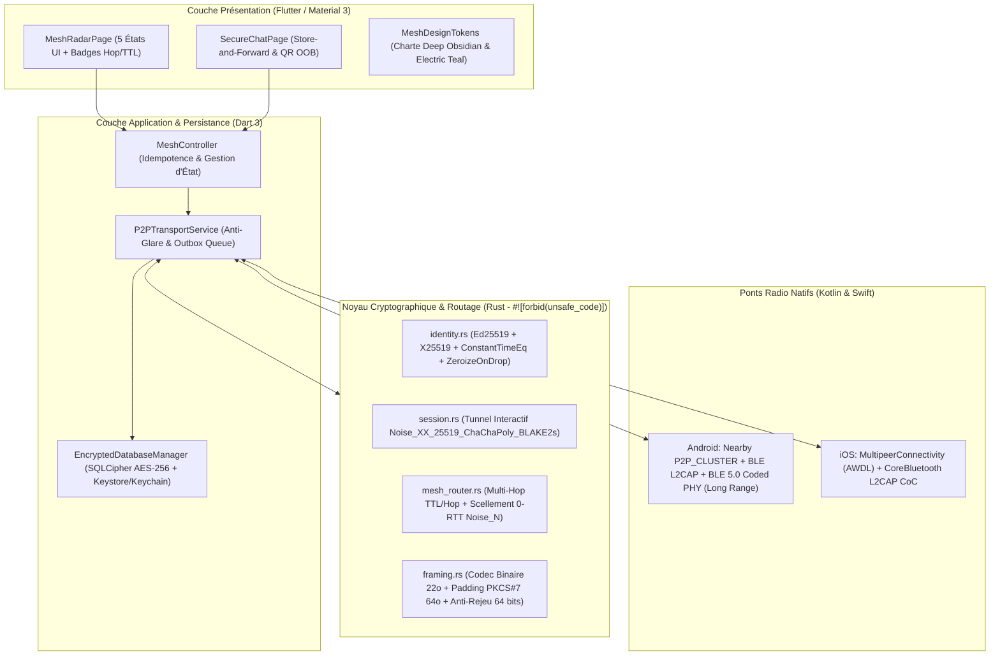

# SansInternet — Messagerie Hors-Ligne Pair-à-Pair (P2P / Multi-Hop Mesh)

Application mobile cross-platform (**Flutter + Noyau Cryptographique Rust FFI**) permettant à des utilisateurs de communiquer en temps réel et en différé (*Store-and-Forward*) **sans aucune connexion Internet ni serveur centralisé**.

Conçue selon une architecture **Zero-Trust / Zero-Vulnerability**, elle combine la découverte radio directe (**Wi-Fi Direct, Apple AWDL, BLE L2CAP CoC**), l'extension longue portée (**BLE 5.0 Coded PHY S=8** et routage **Multi-Hop Gossip** compatible **LoRa Sub-GHz**), un chiffrement de bout en bout (**Noise Protocol Framework + Ed25519**) et un stockage local intégralement chiffré (**SQLCipher AES-256**).

---

## 1. Architecture du Système



---

## 2. Garanties Cryptographiques & Sécurité Défensive

| Composant | Standard Implémenté | Fichier Source |
| :--- | :--- | :--- |
| **Handshake Direct (1 Saut)** | `Noise_XX_25519_ChaChaPoly_BLAKE2s` (Authentification mutuelle, confidentialité des identités et *Perfect Forward Secrecy*) | `rust_core/src/session.rs` |
| **Routage Longue Portée (Multi-Hop 0-RTT)** | `Noise_N_25519_ChaChaPoly_BLAKE2s` + Signature interne `Ed25519` (Chiffrement asymétrique unidirectionnel traversant $N$ relais aveugles) | `rust_core/src/mesh_router.rs` |
| **Identité & Vérification QR (OOB)** | Clé de signature `Ed25519` liant la clé statique `X25519` ; `PeerId` dérivé par `BLAKE2s-256` ; vérification en temps constant (`subtle::ConstantTimeEq`) | `rust_core/src/identity.rs` |
| **Protection de la RAM** | Effacement automatique des clés secrètes à la libération mémoire via `#[derive(Zeroize, ZeroizeOnDrop)]` | `rust_core/src/identity.rs` |
| **Protection Anti-Rejeu & Analyse de Trafic** | Fenêtre glissante 64 bits (`SlidingReplayWindow` RFC 6479) + Bourrage `PKCS#7` par blocs de 64 octets | `rust_core/src/framing.rs` |
| **Base de Données Locale** | `SQLCipher` (`STRICT` tables, `PRAGMA secure_delete = ON`, `WAL`) avec clé maîtresse de 256 bits générée par `Random.secure()` et scellée dans Android Keystore / iOS Keychain | `lib/core/storage/encrypted_database.dart` |

---

## 3. Interopérabilité Radio & Longue Portée

1. **Haut Débit Proximité (Homogène) :**
   - **Android $\leftrightarrow$ Android :** Google Nearby Connections (`Strategy.P2P_CLUSTER` combinant Bluetooth et Wi-Fi Direct).
   - **iOS $\leftrightarrow$ iOS :** Apple `MultipeerConnectivity` (`MCSession` sur Wi-Fi Direct / AWDL).
2. **Pont Universel Inter-Plateformes (Android $\leftrightarrow$ iOS) :**
   - Canaux orientés connexion **BLE L2CAP CoC** (`listenUsingInsecureL2capChannel` sous Android 10+ et `publishL2CAPChannel` sous iOS) partageant l'UUID de service `0000FD9A-0000-1000-8000-00805F9B34FB`.
3. **Longue Portée (Multi-Hop & BLE 5.0 Coded PHY) :**
   - Activation automatique du mode **BLE 5.0 Long Range (`PHY_LE_CODED` S=8)** sur les puces Android compatibles.
   - Enveloppe de routage binaire de 28 octets (`MeshRelayEnvelope`) avec `ttl` (défaut : 7 sauts), `hop_count`, et cache FIFO/LRU borné anti-boucle (`MultiHopMeshRouter`), directement compatible avec le MTU de 200 octets des passerelles **LoRa Sub-GHz (868/915 MHz)**.

---

## 4. Charte Graphique & Système de Design Tokens

L'interface respecte la grille stricte **8pt**, les cibles tactiles minimales de **48x48 dp**, les **5 états obligatoires** (Skeleton Loader GPU sans reflow, Empty State actionnable, État d'Erreur clair, État Nominal, et Accessibilité WCAG AAA) et la palette **Deep Obsidian & Electric Teal** (`lib/core/theme/mesh_design_tokens.dart`) :

| Rôle Sémantique | Nom du Token | Code Hex |
| :--- | :--- | :--- |
| **Background** | Deep Obsidian (`backgroundDeepObsidian`) | `#0F141C` |
| **Surface / Card** | Midnight Slate (`surfaceMidnightSlate`) | `#1B2432` |
| **Primary Accent** | Electric Teal (`primaryElectricTeal`) | `#00D2B4` |
| **Sent Bubble** | Dark Petrol Teal (`sentBubblePetrolTeal`) | `#084C59` |
| **Received Bubble** | Slate Gray (`receivedBubbleSlateGray`) | `#1F2937` |
| **Status: Online / Verified** | Node Green (`statusNodeGreen`) | `#10B981` |
| **Status: Pending / Hop** | Mesh Amber (`statusMeshAmber`) | `#F59E0B` |
| **Text Primary** | Crisp Off-White (`textCrispOffWhite`) | `#F8FAFC` |
| **Text Muted** | Signal Gray (`textSignalGray`) | `#94A3B8` |

---

## 5. Structure du Projet

```text
SansInternet/
├── rust_core/                                   # Noyau cryptographique & routeur Mesh en Rust
│   ├── Cargo.toml
│   └── src/
│       ├── lib.rs                               # Point d'entrée & tests d'intégration (Noise XX & Multi-Hop)
│       ├── identity.rs                          # Clés Ed25519/X25519, ZeroizeOnDrop & ConstantTimeEq
│       ├── framing.rs                           # Codec WireFrame, Padding PKCS#7 64o & SlidingReplayWindow
│       ├── session.rs                           # Automate Noise_XX_25519_ChaChaPoly_BLAKE2s
│       └── mesh_router.rs                       # Routeur Multi-Hop (TTL, Hop, Anti-Boucle & Noise_N 0-RTT)
├── lib/                                         # Application Flutter (Clean Architecture)
│   ├── main.dart                                # Point d'entrée de l'application
│   ├── core/
│   │   ├── storage/encrypted_database.dart      # Base SQLite chiffrée via SQLCipher + Keystore/Keychain
│   │   └── theme/mesh_design_tokens.dart        # Design Tokens Deep Obsidian & Electric Teal
│   └── features/mesh/
│       ├── domain/entities/                     # Entités immuables MeshPeer & ChatMessage
│       ├── data/p2p_transport_service.dart      # Orchestrateur Radio, Handshake & Store-and-Forward
│       └── presentation/
│           ├── controllers/mesh_controller.dart # Gestion d'état réactive des 5 états UI & Outbox
│           └── pages/                           # Écrans MeshRadarPage & SecureChatPage
├── android/app/src/main/kotlin/.../P2pMeshPlugin.kt # Plugin natif Android (Nearby + BLE L2CAP + Coded PHY)
├── ios/Runner/P2pMeshPlugin.swift               # Plugin natif iOS (Multipeer AWDL + CoreBluetooth L2CAP)
└── test/mesh_controller_test.dart               # Tests automatisés des états UI et du Store-and-Forward
```

---

## 6. Vérification & Commandes de Build

### Vérifier et compiler le noyau cryptographique Rust
```powershell
cd rust_core
cargo check --tests
cargo clippy --all-targets -- -D warnings
```

### Analyser et tester l'application Flutter
```powershell
flutter pub get
flutter analyze
flutter test
```
